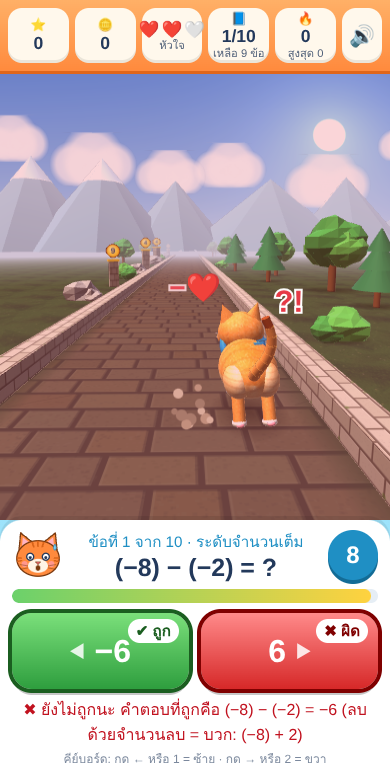

# 🐱 CAT MATH RUN: วิ่งเก็บเหรียญ พิชิตโจทย์คณิต

เกมคณิตศาสตร์ 3 มิติสำหรับนักเรียน แมวส้มวิ่งไปตามทางหิน ผู้เล่นตอบโจทย์บวก–ลบให้ทันเวลาเพื่อเก็บเหรียญ
เล่นบนเบราว์เซอร์ได้ทันที ไม่ต้องติดตั้ง ไม่ต้องล็อกอิน และรองรับคอมพิวเตอร์ แท็บเล็ต และมือถือ

<p align="center">
  
  
</p>

## ▶️ เล่นออนไลน์

เมื่อเปิด GitHub Pages แล้ว (ดูหัวข้อ “วิธีเผยแพร่”) จะเล่นเกมได้ที่

```
https://<ชื่อผู้ใช้ GitHub>.github.io/<ชื่อ repository>/
```

## ✨ ความสามารถ

- ฉาก 3 มิติด้วย WebGL ที่เขียนขึ้นเองทั้งหมด จึงไม่ต้องโหลดไลบรารีหรือรูปภาพจากภายนอก
- ถ้าอุปกรณ์ไม่รองรับ 3 มิติ เกมจะสลับเป็นฉาก 2 มิติให้อัตโนมัติ
- เลือกระดับความยากได้ 4 ระดับ
- รอบละ 10 ข้อ มีหัวใจ 3 ดวง ระบบคะแนน เหรียญ Streak และเอฟเฟกต์ COMBO / PERFECT RUN
- ตัวเลือกผิดสร้างจากความผิดพลาดที่นักเรียนทำบ่อย เช่น ลืมทด หรือเครื่องหมายผิด
- เมื่อตอบผิด เกมจะแสดงคำตอบที่ถูก และมีคำใบ้ในข้อที่ลบด้วยจำนวนลบ
- มีเสียงเอฟเฟกต์ที่ปิดได้ และโหมดลดการเคลื่อนไหว (`prefers-reduced-motion`)
- เล่นด้วยคีย์บอร์ดได้: ปุ่ม ← หรือ 1 เลือกซ้าย และปุ่ม → หรือ 2 เลือกขวา

| ระดับ | โจทย์ | ตัวอย่าง | เวลาต่อข้อ |
|---|---|---|---|
| ง่าย | บวก–ลบเลข 1 หลัก ผลลัพธ์ 0–9 | 3 + 4, 8 − 5 | 5 วินาที |
| ปานกลาง | บวก–ลบเลข 2 หลัก ไม่มีการทด/ยืม | 43 + 25, 87 − 34 | 7 วินาที |
| ท้าทาย | บวก–ลบเลข 2 หลัก มีการทด/ยืม | 47 + 38, 82 − 14 | 10 วินาที |
| จำนวนเต็ม | บวก–ลบจำนวนเต็ม −10 ถึง 10 | (−5) + 3, 4 − (−6) | 8 วินาที |

**กติกาคะแนน (เหมือนกันทุกระดับ)**
- ตอบถูก 1 ข้อได้ 10 คะแนนและ 1 เหรียญ
- ถ้าตอบถูกติดกันตั้งแต่ข้อที่ 3 ขึ้นไป ได้โบนัสอีก 5 คะแนนและ 1 เหรียญต่อข้อ
- คะแนนเต็มคือ 140 และเหรียญเต็มคือ 18

## 📁 โครงสร้างไฟล์

```
├── index.html            ← ตัวเกมทั้งหมด (HTML + CSS + JavaScript ในไฟล์เดียว)
├── apps-script/
│   └── Code.gs           ← สำหรับเผยแพร่ผ่าน Google Apps Script (ไม่บังคับ)
├── docs/screenshots/     ← ภาพประกอบ README
├── .nojekyll             ← ให้ GitHub Pages ส่งไฟล์ตามที่เป็น
└── README.md
```

## 🚀 วิธีเผยแพร่บน GitHub Pages

1. สร้าง repository ใหม่บน GitHub โดยกด **New repository** ตั้งชื่อ เช่น `cat-math-run` และเลือก **Public**
2. อัปโหลดไฟล์ทั้งหมดในโฟลเดอร์นี้ด้วยวิธีใดวิธีหนึ่ง
   - **ผ่านเว็บ:** กด **Add file → Upload files** แล้วลากไฟล์และโฟลเดอร์ทั้งหมดไปวาง จากนั้นกด **Commit changes**
   - **ผ่านคำสั่ง git:**
     ```bash
     git remote add origin https://github.com/<ชื่อผู้ใช้>/cat-math-run.git
     git branch -M main
     git push -u origin main
     ```
3. ไปที่ **Settings → Pages**
4. ที่หัวข้อ **Source** เลือก **Deploy from a branch**
5. เลือก Branch เป็น `main` และโฟลเดอร์เป็น `/ (root)` แล้วกด **Save**
6. รอประมาณ 1–2 นาที แล้วกดรีเฟรช หน้าเดิมจะแสดงลิงก์ของเกม

> ไฟล์ `.nojekyll` เป็นไฟล์ซ่อน ถ้าอัปโหลดผ่านเว็บแล้วไม่เห็นไฟล์นี้ เกมก็ยังทำงานได้ตามปกติ

## 🟢 วิธีเผยแพร่ผ่าน Google Apps Script (ทางเลือก)

1. เข้า [script.google.com](https://script.google.com) แล้วกด **โปรเจกต์ใหม่**
2. วางโค้ดจาก `apps-script/Code.gs` ลงในไฟล์ `Code.gs`
3. กด **＋ → HTML** แล้วตั้งชื่อว่า `Index` (ตัว I เป็นตัวพิมพ์ใหญ่)
4. วางโค้ดทั้งหมดจาก `index.html` ลงในไฟล์นั้น แล้วกดบันทึก
5. กด **Deploy → New deployment → เว็บแอป** ตั้งค่า “ดำเนินการในฐานะ: ฉัน” และ “ผู้มีสิทธิ์เข้าถึง: ทุกคน” แล้วกด Deploy

## ⚙️ ปรับแต่ง

แก้ค่าในส่วน `CFG` ที่อยู่ต้นสคริปต์ของ `index.html`

| ค่า | ความหมาย |
|---|---|
| `TOTAL_Q` | จำนวนข้อต่อรอบ (ค่าเริ่มต้น 10) |
| `MAX_HEARTS` | จำนวนหัวใจ (ค่าเริ่มต้น 3) |
| `LEVELS.<ระดับ>.time` | เวลาต่อข้อ หน่วยเป็นมิลลิวินาที |
| `LEVELS.integer.range` | ช่วงตัวเลขของระดับจำนวนเต็ม ถ้าเปลี่ยน ให้แก้ `min` และ `max` เป็น ±2 เท่าของค่านี้ด้วย |

## 🧪 การทดสอบ

1. เปิดเกมในเบราว์เซอร์ แล้วกด F12 เพื่อเปิด Console
2. พิมพ์คำสั่ง

   ```js
   CatMathRun.selfTest()
   ```
3. ผลที่ควรได้คือ `passed: true`

คำสั่งนี้จะสุ่มโจทย์ 1,000 รอบต่อระดับ แล้วตรวจว่า
- คำตอบถูกต้องทางคณิตศาสตร์
- ไม่มีโจทย์ซ้ำในรอบเดียวกัน และมีโจทย์บวกกับลบอย่างละ 5 ข้อ
- ตัวเลขอยู่ในช่วงของแต่ละระดับ และเงื่อนไขการทด/ยืมหรือการมีจำนวนลบตรงตามระดับ
- ตัวเลือกทั้งสองไม่ซ้ำกัน
- คะแนนเต็มเท่ากับ 140 และเหรียญเต็มเท่ากับ 18

**รายการตรวจด้วยมือ**
- [ ] ตอบถูกครบ 10 ข้อ ได้ 140 คะแนน และขึ้น PERFECT RUN
- [ ] ตอบผิด 3 ครั้ง เกมจบทันที
- [ ] ปล่อยให้หมดเวลา เสียหัวใจเพียง 1 ดวง
- [ ] กดปุ่มคำตอบรัว ๆ ได้คะแนนครั้งเดียว
- [ ] กดเล่นใหม่ ค่าทั้งหมดรีเซ็ต
- [ ] กดปิดเสียงแล้วเกมยังเล่นได้

## 📝 หมายเหตุ

- ฟอนต์ Mitr โหลดจาก Google Fonts ถ้าโหลดไม่ได้ เกมจะใช้ฟอนต์ไทยของเครื่องแทน
- คะแนนสูงสุดและการตั้งค่าบันทึกไว้ในเบราว์เซอร์ของผู้เล่นแต่ละคน (`localStorage`) และไม่มีการส่งข้อมูลออกนอกเครื่อง
