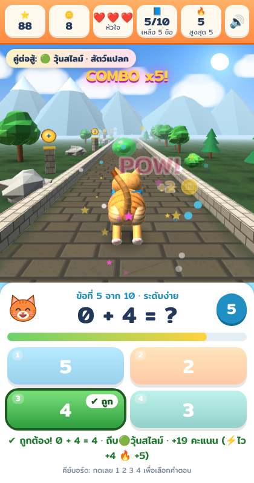
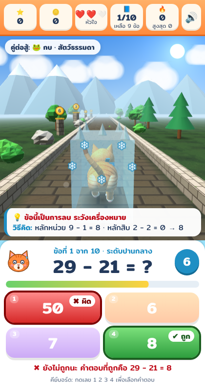
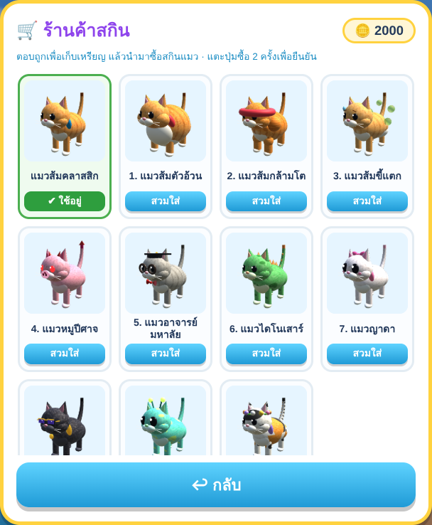
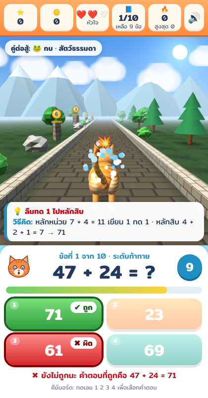
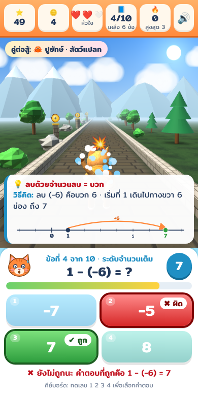
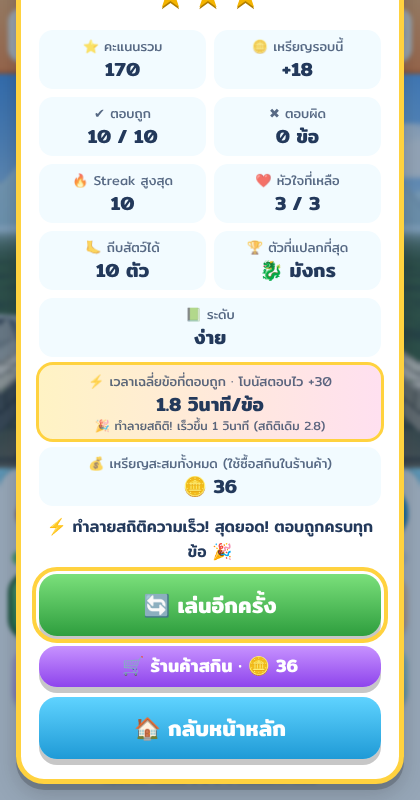
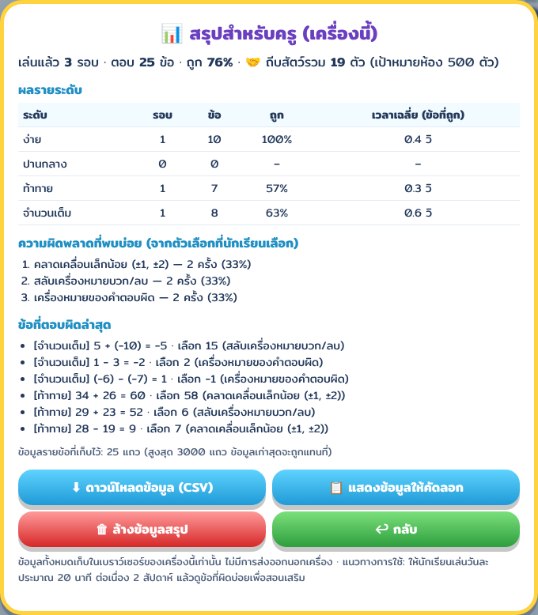
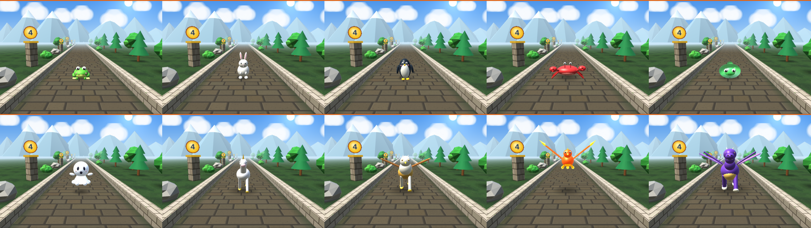

# 🐱 CAT MATH RUN: วิ่งเก็บเหรียญ พิชิตโจทย์คณิต

เกมคณิตศาสตร์ 3 มิติสำหรับนักเรียน แมวส้มวิ่งไปตามทางหิน เลือกคำตอบโจทย์บวก–ลบ 1 ใน 4 ตัวเลือกให้ทันเวลา เพื่อกระโดดถีบสัตว์ที่วิ่งเข้ามา
ยิ่งตอบถูกติดกัน ยิ่งเจอสัตว์แปลกจนถึงสัตว์ในเทพนิยาย เก็บเหรียญไปซื้อสกินแมวได้ 10 แบบ
เล่นบนเบราว์เซอร์ได้ทันที ไม่ต้องติดตั้ง ไม่ต้องล็อกอิน และรองรับคอมพิวเตอร์ แท็บเล็ต และมือถือ

<p align="center">
  
  
  
</p>

## ▶️ เล่นออนไลน์

เมื่อเปิด GitHub Pages แล้ว (ดูหัวข้อ “วิธีเผยแพร่”) จะเล่นเกมได้ที่

```
https://<ชื่อผู้ใช้ GitHub>.github.io/<ชื่อ repository>/
```

## ✨ ความสามารถ

- ฉาก 3 มิติด้วย WebGL ที่เขียนขึ้นเองทั้งหมด จึงไม่ต้องโหลดไลบรารีหรือรูปภาพจากภายนอก
- ถ้าอุปกรณ์ไม่รองรับ 3 มิติ เกมจะสลับเป็นฉาก 2 มิติให้อัตโนมัติ
- เลือกระดับความยากได้ 4 ระดับ
- รอบละ 10 ข้อ มีหัวใจ 3 ดวง ระบบคะแนน เหรียญ Streak และเอฟเฟกต์ COMBO / PERFECT RUN
- ตอบถูก = แมวกระโดดถีบสัตว์ · ตอบผิด/หมดเวลา = โดนแช่แข็งชั่วครู่ แล้ววิ่งต่อ
- สัตว์วิ่งเข้าหาแมวตามเวลาที่เหลือ ช่วยให้เด็กรู้สึกถึงเวลาโดยไม่ต้องดูตัวเลข
- ร้านค้าสกินแมว 10 แบบ ซื้อด้วยเหรียญสะสม
- **4 ตัวเลือกต่อข้อ** ตัวเลือกผิด 3 ตัวสร้างจากความผิดพลาดที่นักเรียนทำบ่อย เช่น ลืมทด ไม่ยืม ตั้งหลักผิด หรือเครื่องหมายผิด
- **คำใบ้วิธีคิดทุกระดับ** เมื่อตอบผิด เกมบอกว่าตัวเลือกที่เลือกน่าจะมาจากความผิดพลาดแบบใด และแสดงวิธีคิดทีละขั้น
- **เส้นจำนวน** ในคำใบ้ของระดับจำนวนเต็ม
- **โบนัสตอบไว** ยิ่งตอบถูกเร็ว ยิ่งได้คะแนนเพิ่ม
- **สถิติส่วนตัว** หน้าจบรอบแสดงเวลาเฉลี่ยข้อที่ตอบถูก เทียบกับสถิติดีที่สุดและครั้งก่อน ให้นักเรียนพยายามทำลายสถิติตัวเอง
- **ตั้งค่าสำหรับครู** เลือกเวลาต่อข้อได้ 5 แบบ (ตามระดับ, ปรับอัตโนมัติ, เพิ่มเวลา ×1.5, ×2, ไม่จับเวลา) เปิดการทวนข้อที่ผิด และตั้งเป้าหมายร่วมของห้อง
- **สรุปสำหรับครู** ผลรายระดับ ความผิดพลาดที่พบบ่อย ข้อที่ผิดล่าสุด และดาวน์โหลดข้อมูลรายข้อเป็นไฟล์ CSV
- มีเสียงเอฟเฟกต์ที่ปิดได้ และโหมดลดการเคลื่อนไหว (`prefers-reduced-motion`)
- เล่นด้วยคีย์บอร์ดได้: กดเลข 1 2 3 4 เพื่อเลือกคำตอบ

| ระดับ | โจทย์ | ตัวอย่าง | เวลาต่อข้อ (ค่าเริ่มต้น) |
|---|---|---|---|
| ง่าย | บวก–ลบเลข 1 หลัก ผลลัพธ์ 0–9 | 3 + 4, 8 − 5 | 5 วินาที |
| ปานกลาง | บวก–ลบเลข 2 หลัก ไม่มีการทด/ยืม | 43 + 25, 87 − 34 | 7 วินาที |
| ท้าทาย | บวก–ลบเลข 2 หลัก มีการทด/ยืม | 47 + 38, 82 − 14 | 10 วินาที |
| จำนวนเต็ม | บวก–ลบจำนวนเต็ม −10 ถึง 10 | (−5) + 3, 4 − (−6) | 8 วินาที |

**กติกาคะแนน (เหมือนกันทุกระดับ)**
- ตอบถูก 1 ข้อได้ 10 คะแนนและ 1 เหรียญ
- **โบนัสตอบไว** ได้อีก 0–5 คะแนน ตามสัดส่วนเวลาที่เหลือตอนตอบ เช่น ตอบเมื่อเหลือเวลาครึ่งหนึ่งได้ +3 (โหมดไม่จับเวลาไม่มีโบนัสนี้)
- ถ้าตอบถูกติดกันตั้งแต่ข้อที่ 3 ขึ้นไป ได้โบนัสอีก 5 คะแนนและ 1 เหรียญต่อข้อ
- ตอบถูกครบ 10 ข้อได้อย่างน้อย 140 คะแนน และสูงสุด 190 คะแนน (เมื่อได้โบนัสตอบไวเต็มทุกข้อ)
- เหรียญสูงสุดต่อรอบคือ 18 เหรียญ (เท่าเดิม)

<p align="center">
  
  
  
</p>

## 👩‍🏫 สำหรับครู

กด **⚙️ ตั้งค่าสำหรับครู** ที่หน้าเริ่มเกม

| การตั้งค่า | ทำอะไร |
|---|---|
| ⏱ เวลาต่อข้อ: ตามระดับ | ใช้เวลาตามตารางระดับด้านบน (ค่าเริ่มต้น) |
| ⏱ ปรับอัตโนมัติ | หลังจบแต่ละรอบ ถ้าตอบถูกตั้งแต่ 85% ลดเวลา 10% ถ้าถูกต่ำกว่า 65% เพิ่มเวลา 10% เพื่อให้อัตราตอบถูกอยู่ราว 75% (ปรับได้ระหว่าง 40%–200% ของเวลามาตรฐาน และต้องตอบอย่างน้อย 3 ข้อจึงปรับ) |
| ⏱ เพิ่มเวลา ×1.5 / ×2 | ให้เวลามากขึ้นสำหรับนักเรียนที่ยังไม่คล่อง |
| ⏱ ไม่จับเวลา (โหมดฝึก) | ไม่มีเวลาจำกัด ไม่มีโบนัสตอบไว และไม่นับเป็นคะแนนสูงสุด เหมาะกับการฝึก “แม่นก่อน แล้วค่อยเร็ว” หรือนักเรียนที่กังวลเรื่องเวลา |
| 🔁 ทวนข้อที่ตอบผิด | ข้อที่ผิดจะกลับมาอีกครั้งหลังผ่านไป 2 ข้อ โดยแทนที่โจทย์ใหม่ (รอบยังมี 10 ข้อ ข้อทวนจะไม่ทวนซ้ำอีก) ปิดไว้เป็นค่าเริ่มต้น เพราะเมื่อเปิด จะมีโจทย์ซ้ำในรอบเดียวกันได้ |
| 🤝 เป้าหมายร่วมของห้อง | ตั้งจำนวนสัตว์ที่ทั้งห้องจะช่วยกันถีบ แต่ละเครื่องแสดงยอดที่ช่วยไปแล้ว ครูรวมยอดจากทุกเครื่อง |

**📊 สรุปสำหรับครู** (ปุ่มอยู่ในส่วนตั้งค่า) แสดงข้อมูลของเครื่องนั้น
- จำนวนรอบ จำนวนข้อ ร้อยละที่ตอบถูก และเวลาเฉลี่ยของข้อที่ตอบถูก แยกตามระดับ
- ความผิดพลาดที่พบบ่อย นับจากชนิดของตัวเลือกผิดที่นักเรียนเลือก เช่น ลืมทด หรือไม่ยืม
- ข้อที่ตอบผิดล่าสุด 8 ข้อ
- **ดาวน์โหลดข้อมูลรายข้อ (CSV)** เปิดด้วย Excel หรือ Google Sheets ได้ แต่ละแถวมีเวลาที่ตอบ ระดับ โหมดเวลา โจทย์ คำตอบ ตัวเลือกที่เลือก ถูก/ผิด เวลาที่ใช้ตอบ (มิลลิวินาที) และชนิดความผิดพลาด เก็บได้สูงสุด 3,000 แถวต่อเครื่อง
- ถ้าเปิดเกมผ่าน Google Apps Script แล้วดาวน์โหลดไม่ได้ ให้กด **📋 แสดงข้อมูลให้คัดลอก** แล้วคัดลอกไปวางในโปรแกรมตารางคำนวณ
- **🗑 ล้างข้อมูลสรุป** (แตะ 2 ครั้ง) ล้างเฉพาะข้อมูลสรุปและข้อมูลรายข้อ เหรียญ สกิน และสถิติส่วนตัวของนักเรียนยังอยู่

<p align="center"></p>

**แนวทางการใช้ในชั้นเรียน:** ให้นักเรียนเล่นวันละประมาณ 20 นาที ต่อเนื่อง 2 สัปดาห์ แล้วใช้หน้าสรุปดูข้อที่ผิดบ่อยเพื่อสอนเสริม

### งานวิจัยที่ใช้เป็นแนวทางพัฒนา

| ฟีเจอร์ | แนวทางจากงานวิจัย |
|---|---|
| สถิติส่วนตัว ทำลายสถิติตัวเอง | Fuchs et al. (2013) การฝึกแบบจับเวลาที่ให้เด็กพยายามทำคะแนนให้ดีกว่าครั้งก่อน ได้ผลด้านการบวก–ลบดีกว่าการฝึกไม่จับเวลา |
| โบนัสตอบไว, ปรับเวลาอัตโนมัติ (~75%) | Klinkenberg, Straatemeier & van der Maas (2011); Maris & van der Maas (2012) ระบบ Math Garden ให้คะแนนทั้งความถูกต้องและเวลาที่ใช้ตอบ และเลือกความยากให้มีโอกาสตอบถูกราว .75 (ในเกมนี้ปรับ “เวลาต่อข้อ” แทนการปรับระดับโจทย์) |
| คำใบ้วิธีคิด | Hattie & Timperley (2007) ผลป้อนกลับเกี่ยวกับกระบวนการคิดช่วยการเรียนรู้ได้ดีกว่าการบอกแค่ถูกหรือผิด |
| เส้นจำนวนในระดับจำนวนเต็ม | Bofferding & Hoffman (2019); Siegler & Ramani (2009) เกมแบบเส้นตรงช่วยความเข้าใจค่าและลำดับของจำนวน |
| โหมดไม่จับเวลา / เพิ่มเวลา | Caviola et al. (2017); Ramirez et al. (2013) แรงกดดันด้านเวลาและความวิตกกังวลทางคณิตศาสตร์อาจส่งผลต่อเด็กบางคน |
| แนวทางเล่นวันละ ~20 นาที 2 สัปดาห์ | Jay et al. (2019) เกมฝึกความคล่องการคิดเลขที่ใช้ในห้องเรียนลักษณะนี้ |
| สรุปสำหรับครู | Codding, Burns & Lukito (2011) โปรแกรมที่ครูทำงานร่วมกับนักเรียนได้ผลดีที่สุด |
| เป้าหมายร่วมของห้อง | Sailer & Homner (2020) การผสมการแข่งขันกับการร่วมมือได้ผลดีกว่าการแข่งขันอย่างเดียว |

> ฟีเจอร์ทวนข้อที่ตอบผิด และการเพิ่มเป็น 4 ตัวเลือก เป็นการออกแบบเพิ่มเติม ยังไม่มีงานวิจัยข้างต้นทดสอบกลไกนี้ในเกมโดยตรง ควรเก็บข้อมูลเพื่อประเมินผล

## 🦶 สัตว์ที่ต้องถีบ (เปลี่ยนตาม Streak)

| Streak | สัตว์ | กลุ่ม |
|---|---|---|
| 0–2 | 🐸 กบ · 🐰 กระต่าย · 🐧 เพนกวิน | สัตว์ธรรมดา |
| 3–5 | 🦀 ปูยักษ์ · 🟢 วุ้นสไลม์ · 👻 ผีน้อย | สัตว์แปลก |
| 6–9 | 🦄 ยูนิคอร์น · 🦅 กริฟฟิน · 🔥 นกฟีนิกซ์ · 🐉 มังกร | สัตว์ในเทพนิยาย |

ตอบผิดหรือหมดเวลา Streak กลับเป็น 0 สัตว์ตัวถัดไปจึงกลับมาเป็นกบ

<p align="center"></p>

## 🛒 ร้านค้าสกิน

เหรียญที่ได้จากการตอบถูกจะสะสมไว้ในกระเป๋า (เข้ากระเป๋าทันทีที่ตอบถูก) แล้วนำไปซื้อสกินได้ แตะปุ่มซื้อ 2 ครั้งเพื่อยืนยัน

| # | สกิน | ราคา | | # | สกิน | ราคา |
|---|---|---|---|---|---|---|
| – | แมวส้มคลาสสิก | ฟรี | | 6 | แมวไดโนเสาร์ | 75 |
| 1 | แมวส้มตัวอ้วน | 15 | | 7 | แมวญาดา | 90 |
| 2 | แมวส้มกล้ามโต | 25 | | 8 | แมวอีเพิ่ม | 110 |
| 3 | แมวส้มขี้แตก | 35 | | 9 | แมวเอเลี่ยน | 130 |
| 4 | แมวหมูปีศาจ | 50 | | 10 | แมวจูจู | 160 |
| 5 | แมวอาจารย์มหาลัย | 60 | | | | |

> เหรียญและสกินบันทึกไว้ในเบราว์เซอร์ของแต่ละเครื่อง ถ้าล้างข้อมูลเบราว์เซอร์ เปลี่ยนเครื่อง หรือเปิดโหมดไม่ระบุตัวตน เหรียญจะเริ่มใหม่

## 📁 โครงสร้างไฟล์

```
├── index.html            ← ตัวเกมทั้งหมด (HTML + CSS + JavaScript ในไฟล์เดียว)
├── apps-script/
│   └── Code.gs           ← สำหรับเผยแพร่ผ่าน Google Apps Script (ไม่บังคับ)
├── docs/screenshots/     ← ภาพประกอบ README
├── docs/how-to-install/  ← คู่มือภาพติดตั้งบน GitHub ทีละขั้นตอน
├── .nojekyll             ← ให้ GitHub Pages ส่งไฟล์ตามที่เป็น
└── README.md
```

## 🚀 วิธีเผยแพร่บน GitHub Pages

> 📸 **คู่มือแบบภาพทีละขั้นตอน** ดูได้ที่โฟลเดอร์ [`docs/how-to-install`](docs/how-to-install) (ภาพ step-1 ถึง step-9)

1. สร้าง repository ใหม่บน GitHub โดยกด **New repository** ตั้งชื่อ เช่น `cat-math-run` และเลือก **Public**
2. อัปโหลดไฟล์ทั้งหมดในโฟลเดอร์นี้ด้วยวิธีใดวิธีหนึ่ง
   - **ผ่านเว็บ:** กด **Add file → Upload files** แล้วลากไฟล์และโฟลเดอร์ทั้งหมดไปวาง จากนั้นกด **Commit changes**
   - **ผ่านคำสั่ง git:**
     ```bash
     git remote add origin https://github.com/<ชื่อผู้ใช้>/cat-math-run.git
     git branch -M main
     git push -u origin main
     ```
3. ไปที่ **Settings → Pages**
4. ที่หัวข้อ **Source** เลือก **Deploy from a branch**
5. เลือก Branch เป็น `main` และโฟลเดอร์เป็น `/ (root)` แล้วกด **Save**
6. รอประมาณ 1–2 นาที แล้วกดรีเฟรช หน้าเดิมจะแสดงลิงก์ของเกม

> ไฟล์ `.nojekyll` เป็นไฟล์ซ่อน ถ้าอัปโหลดผ่านเว็บแล้วไม่เห็นไฟล์นี้ เกมก็ยังทำงานได้ตามปกติ

## 🟢 วิธีเผยแพร่ผ่าน Google Apps Script (ทางเลือก)

1. เข้า [script.google.com](https://script.google.com) แล้วกด **โปรเจกต์ใหม่**
2. วางโค้ดจาก `apps-script/Code.gs` ลงในไฟล์ `Code.gs`
3. กด **＋ → HTML** แล้วตั้งชื่อว่า `Index` (ตัว I เป็นตัวพิมพ์ใหญ่)
4. วางโค้ดทั้งหมดจาก `index.html` ลงในไฟล์นั้น แล้วกดบันทึก
5. กด **Deploy → New deployment → เว็บแอป** ตั้งค่า “ดำเนินการในฐานะ: ฉัน” และ “ผู้มีสิทธิ์เข้าถึง: ทุกคน” แล้วกด Deploy

## ⚙️ ปรับแต่ง

แก้ค่าในส่วน `CFG` ที่อยู่ต้นสคริปต์ของ `index.html`

| ค่า | ความหมาย |
|---|---|
| `TOTAL_Q` | จำนวนข้อต่อรอบ (ค่าเริ่มต้น 10) |
| `MAX_HEARTS` | จำนวนหัวใจ (ค่าเริ่มต้น 3) |
| `LEVELS.<ระดับ>.time` | เวลาต่อข้อ หน่วยเป็นมิลลิวินาที |
| `CHOICES` | จำนวนตัวเลือกต่อข้อ (ค่าเริ่มต้น 4 รองรับ 2–4 ตามจำนวนปุ่มในหน้าเว็บ) |
| `SPEED_BONUS_MAX` | โบนัสตอบไวสูงสุดต่อข้อ (ค่าเริ่มต้น 5) |
| `AUTO_TARGET` / `AUTO_STEP` / `AUTO_MIN` / `AUTO_MAX` | เกณฑ์และขนาดการปรับเวลาในโหมดอัตโนมัติ |
| `RETRY_GAP` | ข้อที่ผิดจะกลับมาหลังผ่านไปกี่ข้อ (ค่าเริ่มต้น 2) |
| `RECORD_MIN_CORRECT` | ต้องตอบถูกอย่างน้อยกี่ข้อจึงบันทึกสถิติความเร็ว (ค่าเริ่มต้น 5) |
| `LOG_MAX` | จำนวนแถวข้อมูลรายข้อสูงสุดที่เก็บในเครื่อง (ค่าเริ่มต้น 3,000) |
| `CFG.SKINS` | ชื่อ ราคา และสีของสกินทั้ง 11 แบบ |
| `CFG.CREATURES` | ชื่อและอีโมจิของสัตว์ 10 ชนิด |
| `CFG.FREEZE_TIME` | เวลาที่โดนแช่แข็ง (วินาที) |
| `LEVELS.integer.range` | ช่วงตัวเลขของระดับจำนวนเต็ม ถ้าเปลี่ยน ให้แก้ `min` และ `max` เป็น ±2 เท่าของค่านี้ด้วย |

## 🧪 การทดสอบ

1. เปิดเกมในเบราว์เซอร์ แล้วกด F12 เพื่อเปิด Console
2. พิมพ์คำสั่ง

   ```js
   CatMathRun.selfTest()
   ```
3. ผลที่ควรได้คือ `passed: true`

คำสั่งนี้จะสุ่มโจทย์ 1,000 รอบต่อระดับ แล้วตรวจว่า
- คำตอบถูกต้องทางคณิตศาสตร์
- ไม่มีโจทย์ซ้ำในรอบเดียวกัน และมีโจทย์บวกกับลบอย่างละ 5 ข้อ
- ตัวเลขอยู่ในช่วงของแต่ละระดับ และเงื่อนไขการทด/ยืมหรือการมีจำนวนลบตรงตามระดับ
- ตัวเลือกทั้ง 4 ตัวไม่ซ้ำกัน มีคำตอบถูก 1 ตัว และตัวเลือกผิดทุกตัวมีชนิดความผิดพลาดพร้อมคำใบ้
- วิธีคิดทีละขั้นลงท้ายด้วยคำตอบที่ถูก และเส้นจำนวนแสดงคำตอบ
- คะแนนเต็มไม่รวมโบนัสตอบไวเท่ากับ 140 สูงสุดรวมโบนัสเท่ากับ 190 และเหรียญเต็มเท่ากับ 18
- การปรับเวลาโหมดอัตโนมัติถูกต้องตามเกณฑ์

**รายการตรวจด้วยมือ**
- [ ] ตอบถูกครบ 10 ข้อ ได้ 140–190 คะแนน ถีบครบตั้งแต่กบถึงมังกร และขึ้น PERFECT RUN
- [ ] ตอบผิด มีกล่องคำใบ้วิธีคิด และระดับจำนวนเต็มมีเส้นจำนวน
- [ ] จบรอบแล้วเห็นเวลาเฉลี่ยข้อที่ตอบถูก และเล่นรอบถัดไปเร็วขึ้นแล้วขึ้น “ทำลายสถิติ”
- [ ] โหมดไม่จับเวลา ตัวจับเวลาแสดง ∞ และไม่หมดเวลา
- [ ] สรุปสำหรับครูแสดงผล และดาวน์โหลด CSV ได้
- [ ] ตอบผิด แมวโดนแช่แข็งแล้ววิ่งต่อ สัตว์ตัวต่อไปกลับเป็นกบ
- [ ] ซื้อสกินในร้านค้า (แตะ 2 ครั้ง) เหรียญลดลง และแมวเปลี่ยนสกินทันที
- [ ] ตอบผิด 3 ครั้ง เกมจบทันที
- [ ] ปล่อยให้หมดเวลา เสียหัวใจเพียง 1 ดวง
- [ ] กดปุ่มคำตอบรัว ๆ ได้คะแนนครั้งเดียว
- [ ] กดเล่นใหม่ ค่าทั้งหมดรีเซ็ต
- [ ] กดปิดเสียงแล้วเกมยังเล่นได้

## 📝 หมายเหตุ

- ฟอนต์ Mitr โหลดจาก Google Fonts ถ้าโหลดไม่ได้ เกมจะใช้ฟอนต์ไทยของเครื่องแทน
- คะแนนสูงสุด สถิติ การตั้งค่า และข้อมูลรายข้อบันทึกไว้ในเบราว์เซอร์ของแต่ละเครื่อง (`localStorage`) และไม่มีการส่งข้อมูลออกนอกเครื่อง
- ถ้านักเรียนหลายคนใช้เครื่องเดียวกัน ข้อมูลสรุปจะรวมกัน ควรกดล้างข้อมูลสรุปก่อนเปลี่ยนผู้เล่น หรือให้แต่ละคนใช้เครื่องของตัวเอง
